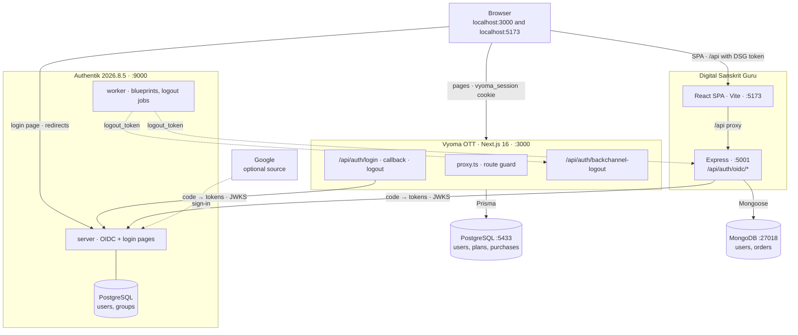
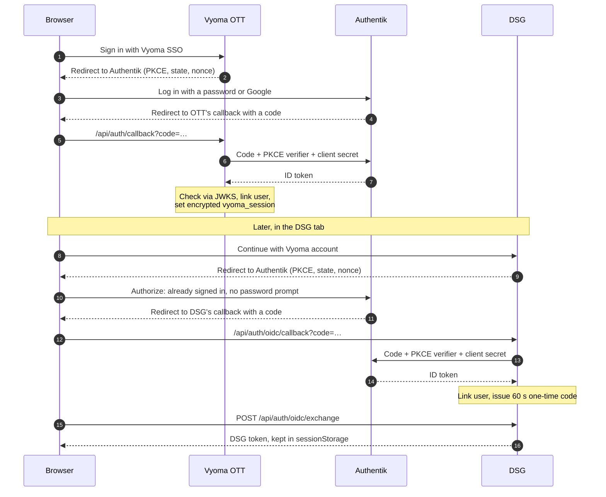
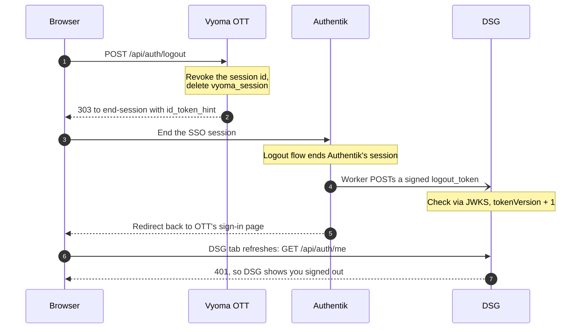

# Architecture

One Vyoma account works for every app. Authentik checks who you are, and each app keeps its own data and its own session. This page shows how the demo in this repository fits together. The code follows `ott-sso.md` and `dsg-sso.md`.

## How the pieces connect

The browser talks to all three services. Each app swaps a login code for tokens with Authentik server-to-server, and Authentik calls the apps back when a session ends.

Neither app ever sees a password. Each one checks the ID token's signature against Authentik's public keys (JWKS), and then runs its own session. Dotted arrows are back-channel logout and the optional Google source.

## Signing in once, using both apps

The second app still runs the full OIDC flow. Authentik recognises its own session cookie and answers straight away, so step 10 needs no password.

## Logging out of both apps

Logging out of OTT ends three sessions: OTT's own, Authentik's, and DSG's. DSG learns about it server-to-server, so even a copied DSG token stops working.

OTT revokes by session id, so other browsers stay signed in. DSG bumps a per-user counter, which ends all of that person's DSG sessions, as DSG does today. Logging out of DSG works the same way in reverse.

## Who owns what

Authentik answers "who is this?" The apps answer "what may they use?" The same `sub` (the user's UUID) joins a person's records across both apps.

| Data | Kept in |
| --- | --- |
| Passwords, MFA, Google link | Authentik |
| Staff roles, as groups | Authentik |
| OTT plan, purchases, watch progress | OTT PostgreSQL |
| DSG orders and library | DSG MongoDB |
| Link to the Vyoma account | `authentikId` (OTT), `authentikSub` (DSG) |
| OTT session | Encrypted `vyoma_session` cookie, 7 days, revoked by session id |
| DSG session | DSG token in `sessionStorage`, 8 h staff / 12 h customers, revoked by `tokenVersion` |

## How groups become roles

| Authentik group | Becomes |
| --- | --- |
| `vyoma-superadmins` | OTT `SUPER_ADMIN`: every admin page |
| `vyoma-admins` | OTT `ADMIN`: every admin page |
| `vyoma-managers` | OTT `MANAGER`: no Users or Invoices |
| `vyoma-finance` | OTT `FINANCE`: no Courses or Users |
| `dsg-super-admin` | DSG level 1: every page |
| `dsg-staff` + `dsg-page-*` | DSG level 2: only the listed pages |
| None of these | Customer in both apps |

OTT reads its role from the `vyoma_roles` scope (`role` claim). DSG reads `dsg_roles` from the `dsg` scope. Both apps overwrite the stored role at every login, so a change in Authentik takes effect at the user's next sign-in.
